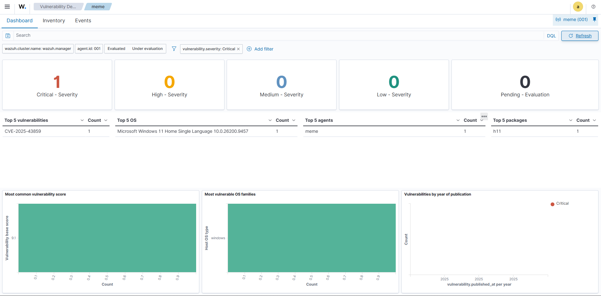
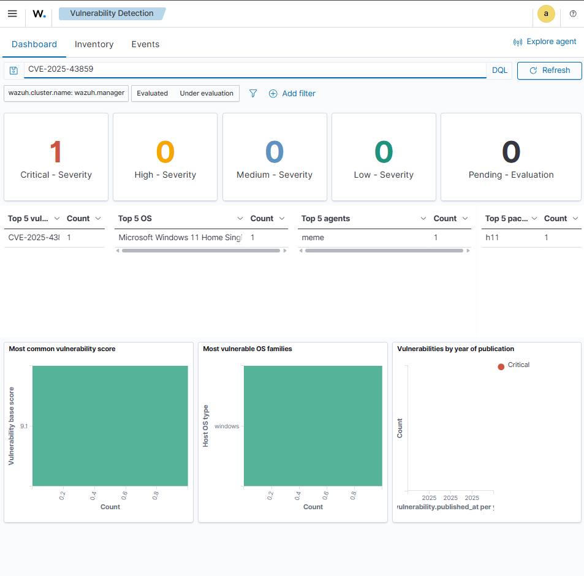
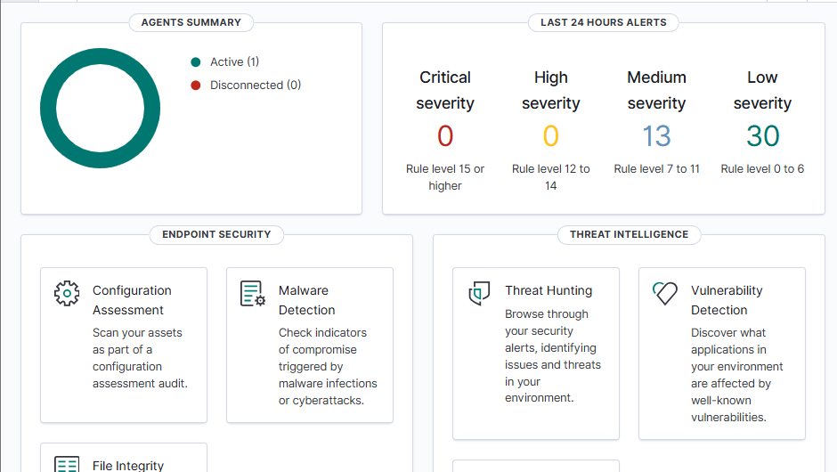
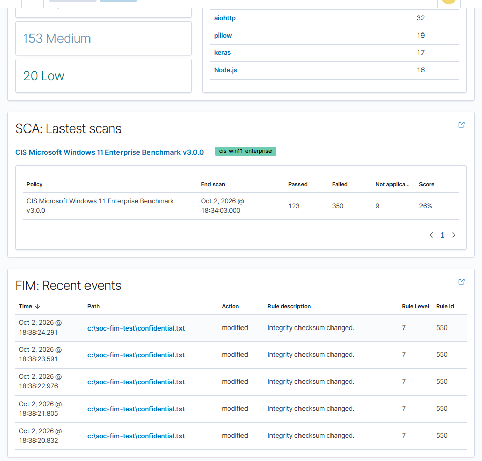
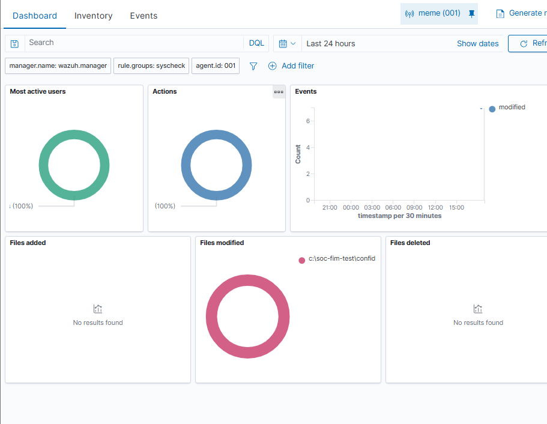

# Phase 1: Endpoint Security & Monitoring (Wazuh)

## Overview

Deployed a standalone **Wazuh** SIEM to monitor a Windows endpoint. This phase covers vulnerability detection and remediation, plus custom **File Integrity Monitoring (FIM)**.

**Config used:** [`configs/windows-agent-ossec.conf`](./configs/windows-agent-ossec.conf)

---

## 1. Vulnerability Detection & Remediation (CVE-2025-43859)

| Step | What I did |
| :--- | :--- |
| **Detect** | Wazuh's vulnerability detector flagged a critical CVE in the `h11` Python package. |
| **Remediate** | Upgraded `h11` using PowerShell and resolved the resulting `httpcore` dependency conflict. |
| **Verify** | Confirmed in the dashboard that the critical alert cleared. |

**Before: critical finding**


**Affected package**


**After: no critical findings**


---

## 2. Custom File Integrity Monitoring

Edited the agent's `<syscheck>` block in `ossec.conf` to monitor a dedicated test directory in real time:

```xml
<directories check_all="yes" realtime="yes">C:\SOC-FIM-Test</directories>
```

I then modified files in that directory to simulate unauthorized changes. Wazuh raised **Level 7 "Integrity checksum changed"** alerts.



