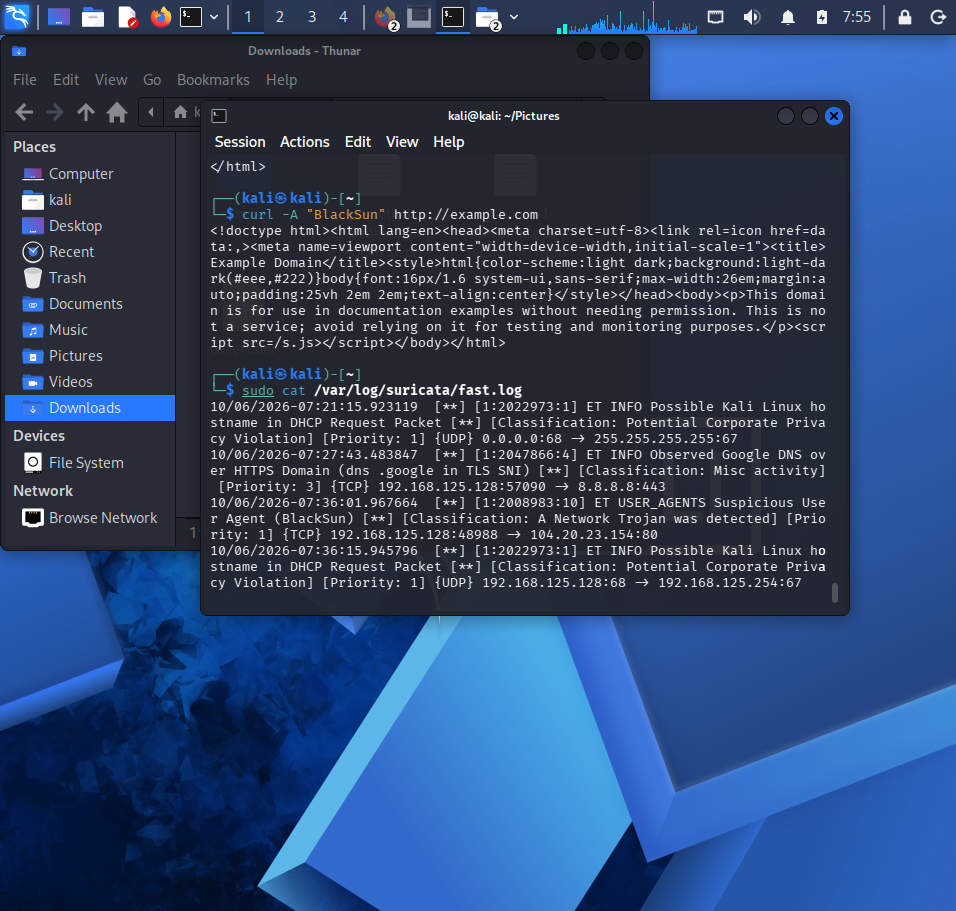
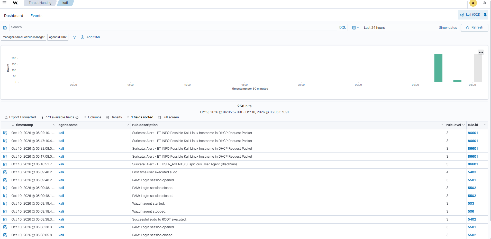
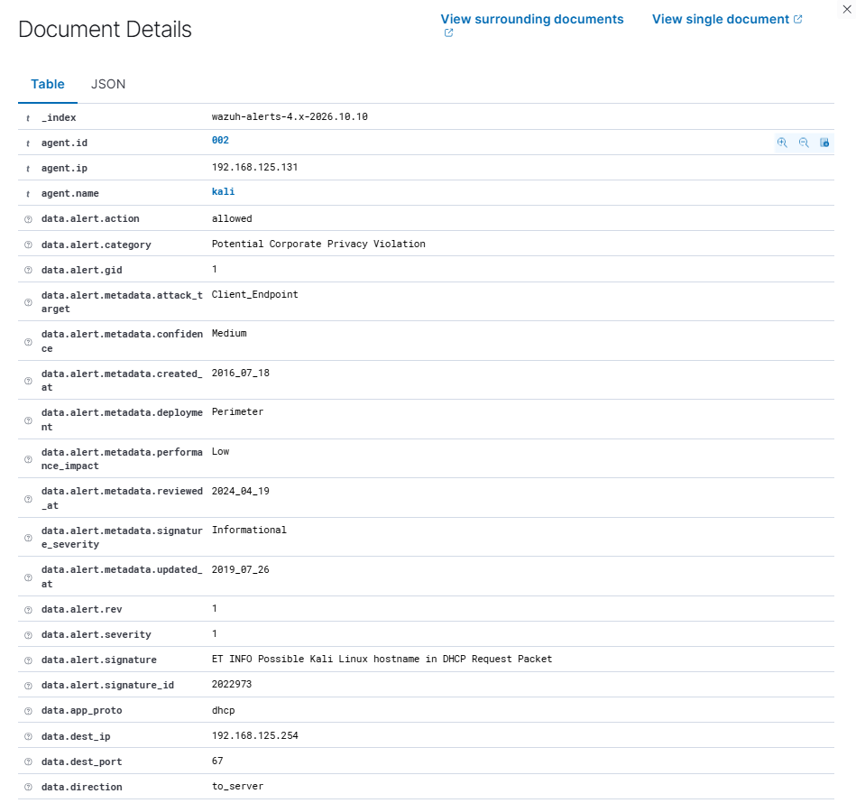

# Phase 2: Network IDS Integration (Suricata + Wazuh)

## Overview

Extended detection from host-level to network-level by integrating **Suricata** with the **Wazuh** SIEM. Alerts raised on a Kali Linux sensor are written as JSON and ingested into the Wazuh Manager in near real time.

## Architecture & Data Flow

```
Kali (Suricata) ──eve.json──▶ Wazuh agent (logcollector) ──VMnet8──▶ Wazuh Manager (Docker on Windows) ──▶ Dashboard
```

- **Sensor:** Kali Linux running Suricata, writing alerts to `/var/log/suricata/eve.json`.
- **Host:** Windows machine running single-node Wazuh Manager, Indexer and Dashboard in Docker.
- **Network:** VMware NAT adapter `VMnet8` (`192.168.125.0/24`).

## Configuration

Added this block to the Wazuh agent's `ossec.conf` on the sensor ([`configs/wazuh-agent-suricata-localfile.xml`](./configs/wazuh-agent-suricata-localfile.xml)):

```xml
<localfile>
  <log_format>json</log_format>
  <location>/var/log/suricata/eve.json</location>
</localfile>
```

## Attack Simulation & Triage

**1. Trigger.** Sent an HTTP request with a known-malicious User-Agent (Emerging Threats SID 2008983):

```bash
curl -A "BlackSun" http://example.com
```

**2. Detect.** Wazuh fired rule **86601**: *Suricata: Alert, ET USER_AGENTS Suspicious User Agent (BlackSun)*.

**3. Triage.** From the alert metadata:

| Field | Value |
| :--- | :--- |
| Category | A Network Trojan was detected |
| Severity | 1 |
| Destination port | 80 |




