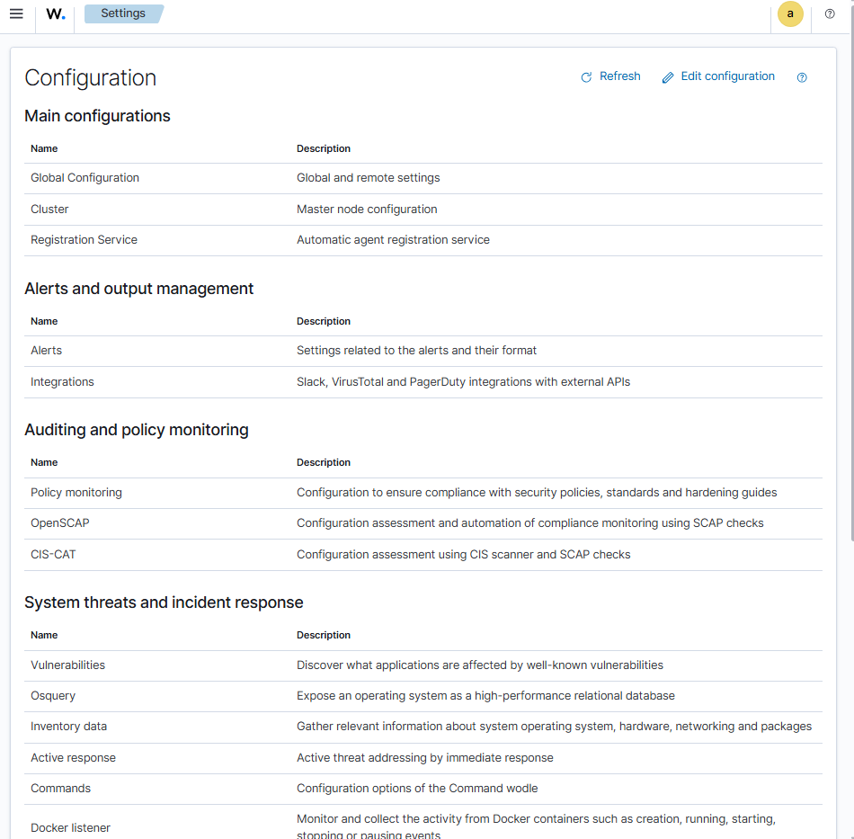
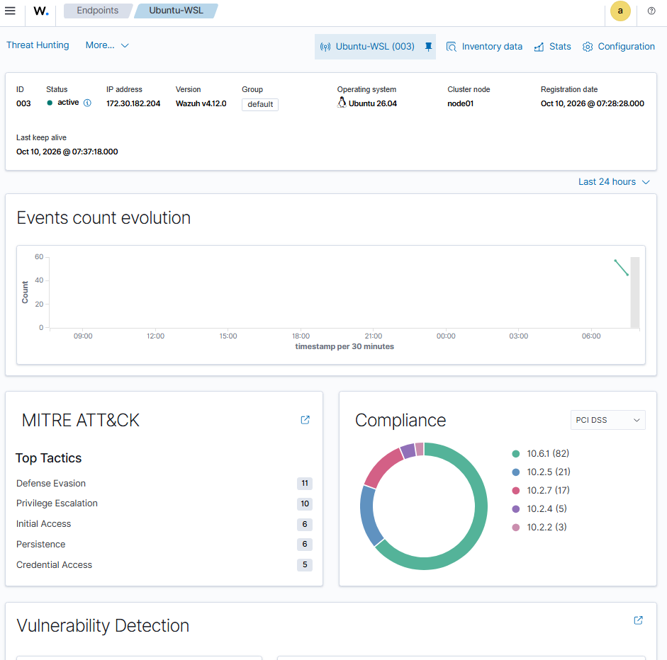
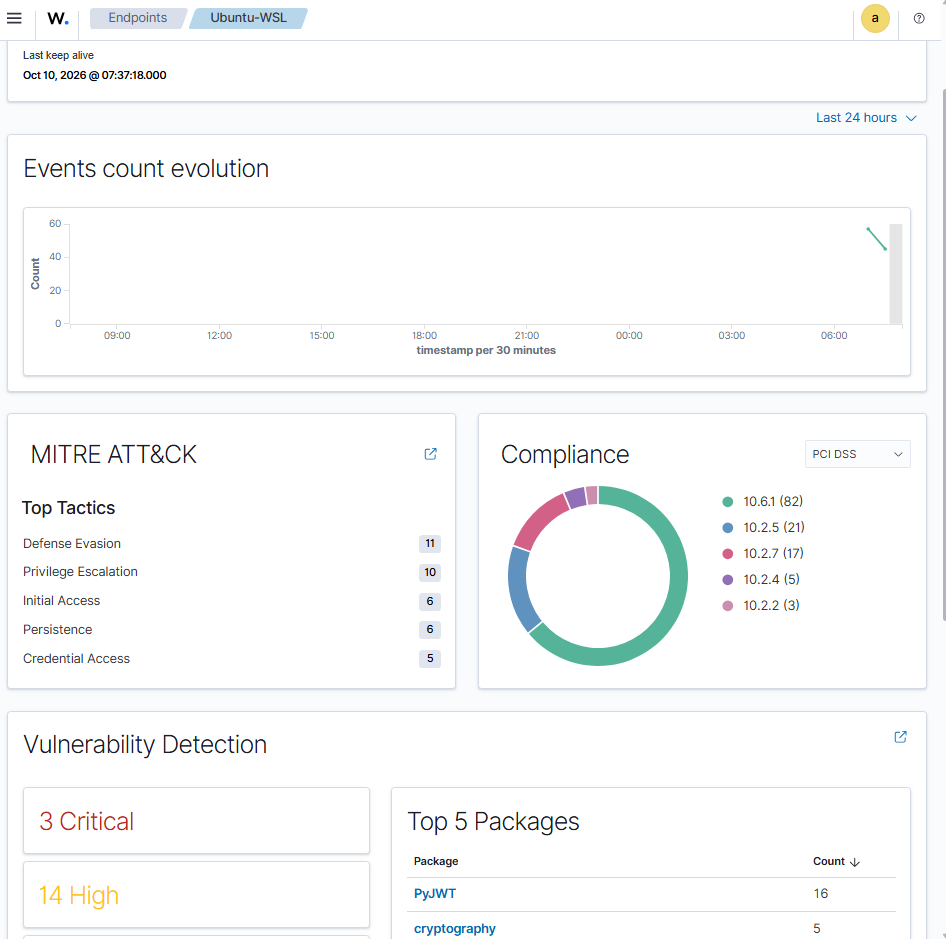
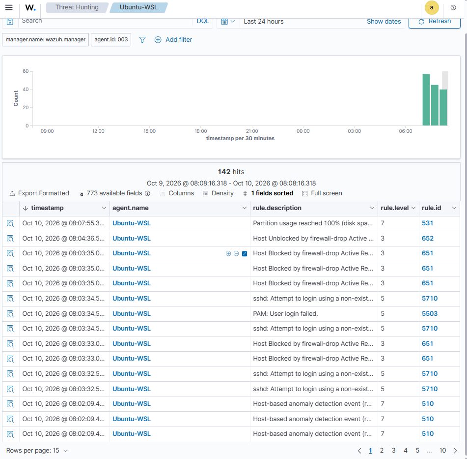
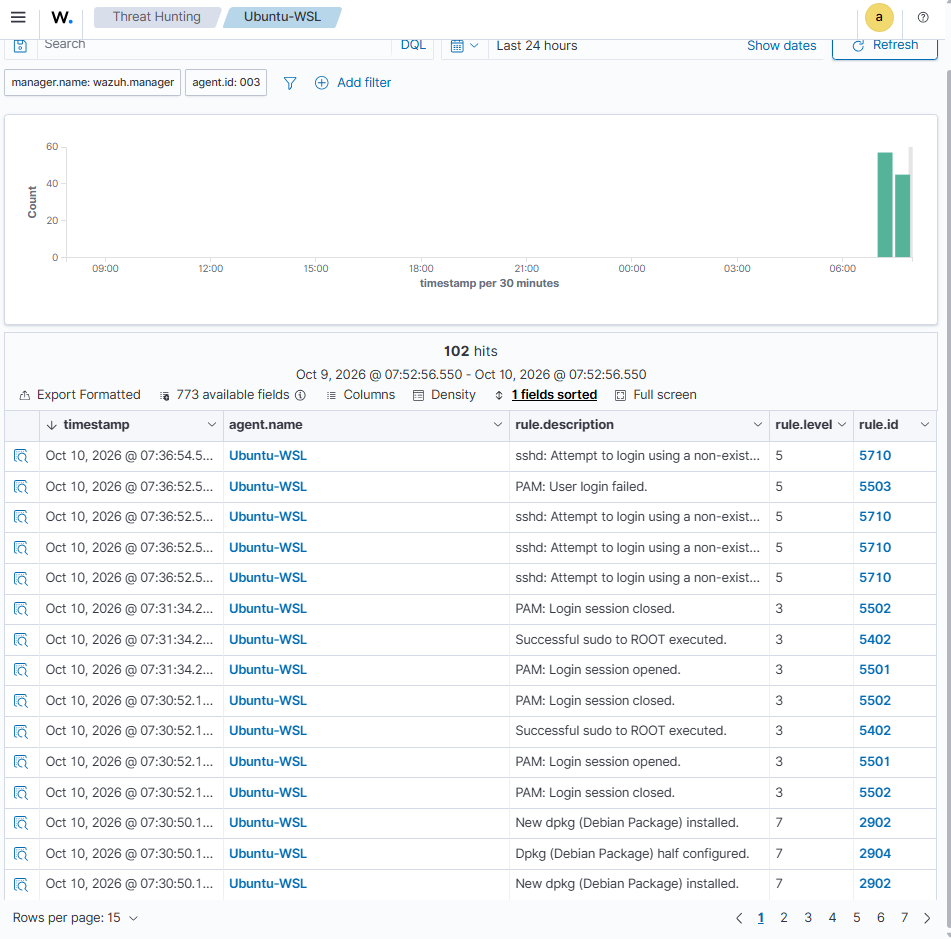
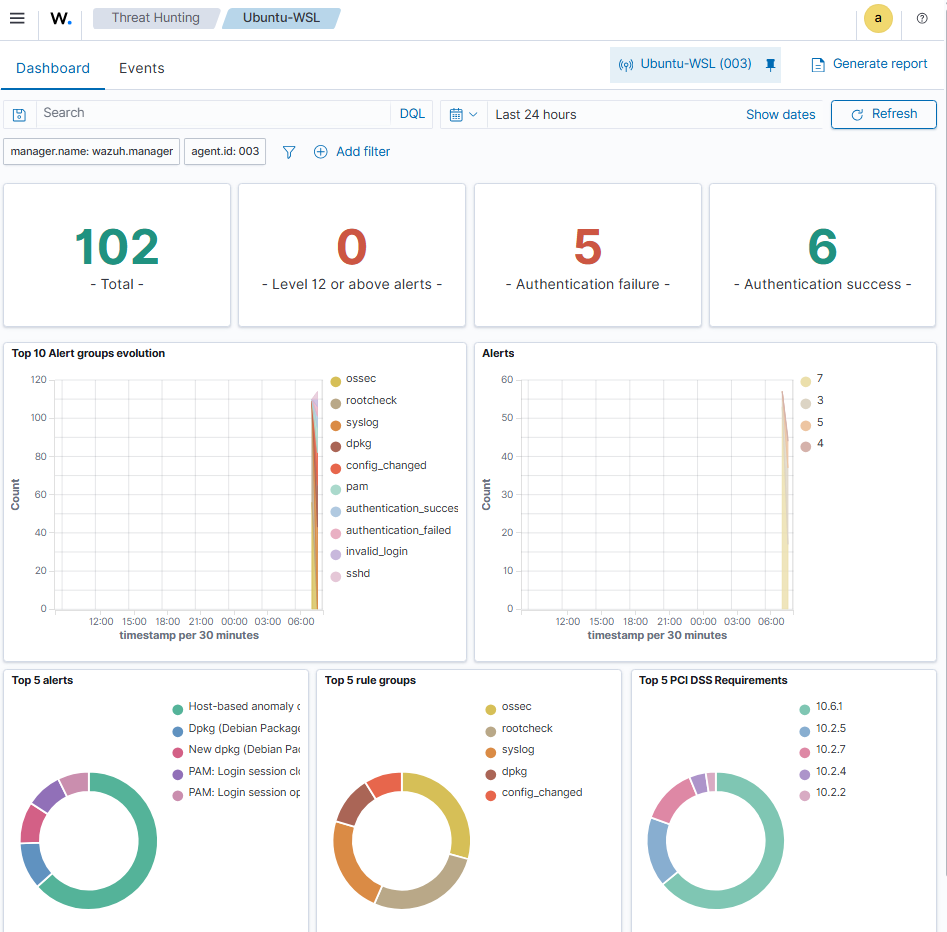

# Phase 3: Automated Active Response (Wazuh)

## Objective

Detect an SSH brute-force attack (Hydra) and automatically block the attacker's IP with Wazuh Active Response (`firewall-drop`, which uses iptables).

## Attack & Defense Flow

1. **Attack:** a Kali Linux VM runs Hydra against SSH on an Ubuntu (WSL) endpoint.
2. **Detect:** the Wazuh agent forwards auth logs to the Manager, which matches **Rule 5716** (`sshd: authentication failed`).
3. **Respond:** the Manager triggers the `<active-response>` block below.
4. **Contain:** the Ubuntu endpoint runs `firewall-drop` and adds the attacker's IP to the iptables drop list for 60 seconds. Wazuh logs this as **Rule 651** (host blocked by `firewall-drop`).

## Configuration

Added to the Manager's `ossec.conf` ([`configs/active-response-firewall-drop.xml`](./configs/active-response-firewall-drop.xml)):

```xml
<active-response>
  <command>firewall-drop</command>
  <location>local</location>
  <rules_id>5710,5503,5716,5720,5712</rules_id>
  <timeout>60</timeout>
</active-response>
```

| Setting | Meaning |
| :--- | :--- |
| `command` | Built-in `firewall-drop` script |
| `location: local` | Runs on the agent that generated the alert |
| `rules_id` | SSH/auth failure rules that trigger the response |
| `timeout: 60` | Block is lifted after 60 seconds |

## Evidence

**Manager configuration**


**Brute-force detected**


**Events count**


**Attacker IP blocked in iptables**


**Rule 651 confirms the block**


**Ubuntu agent dashboard**

