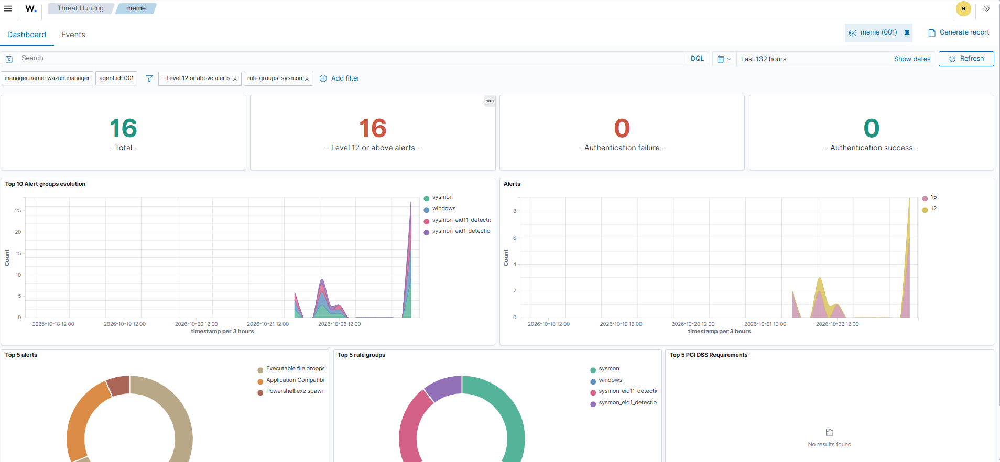
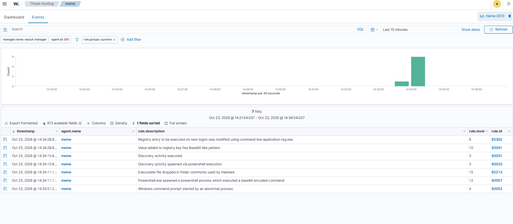
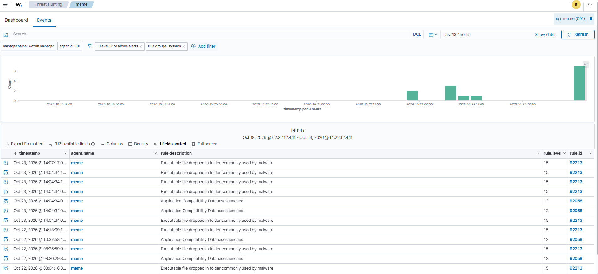
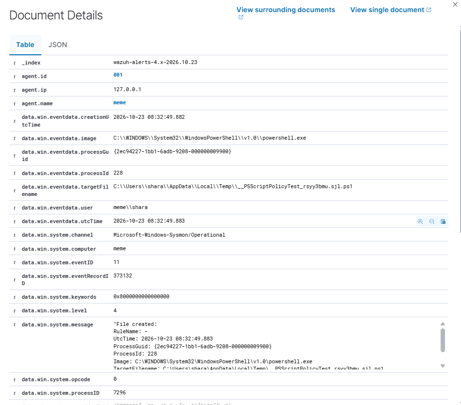
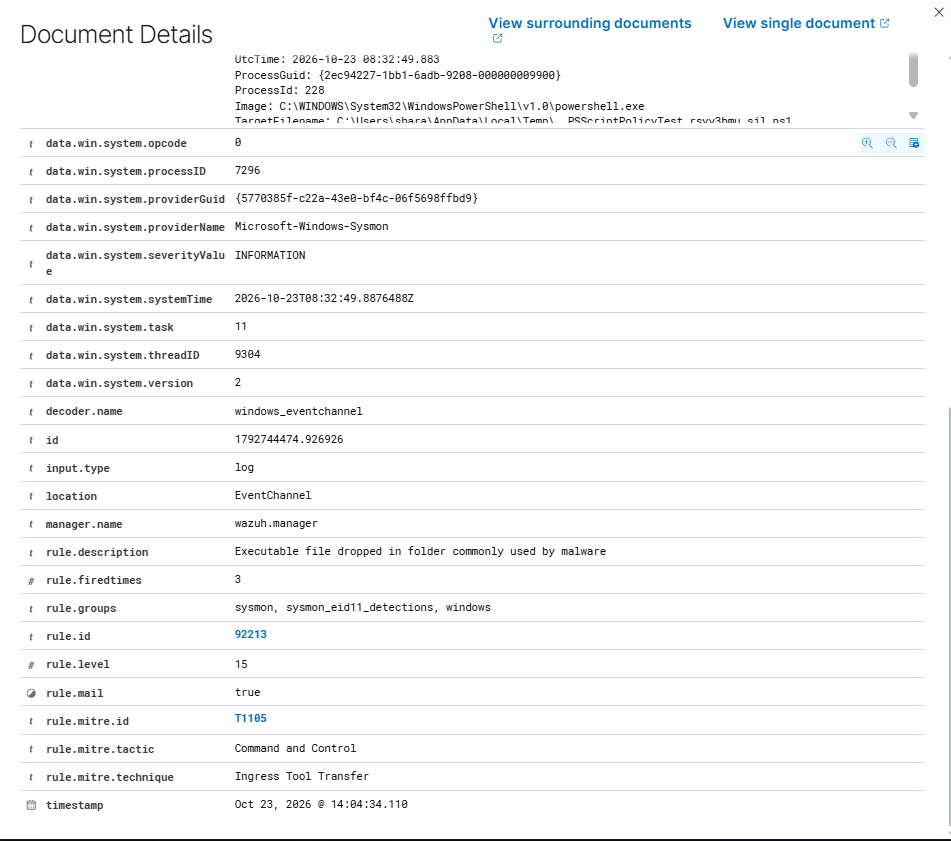
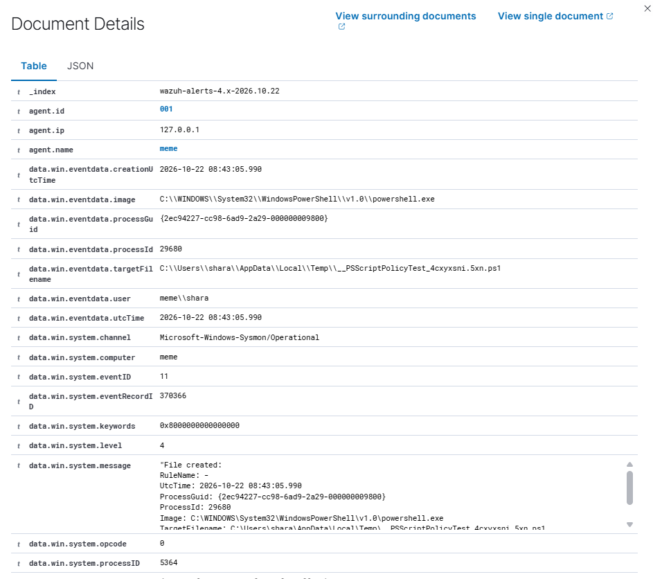
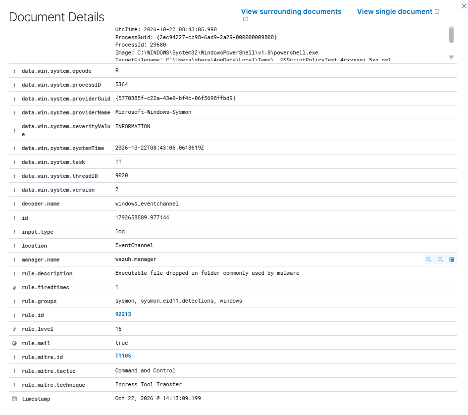
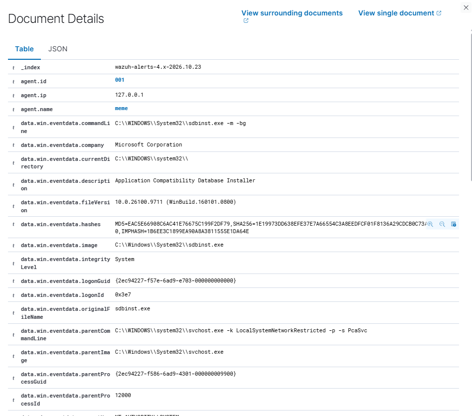
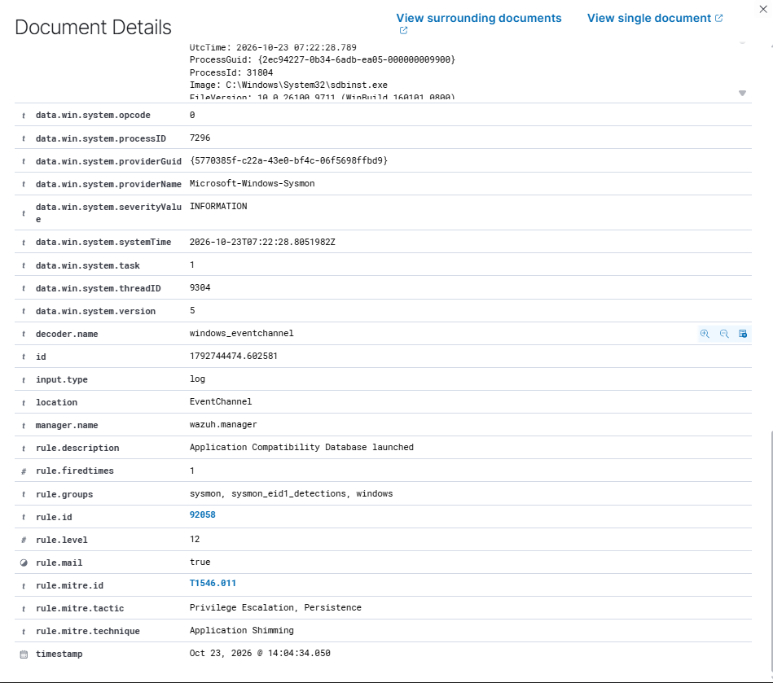

# Phase 4: Windows Sysmon Log Analysis (Wazuh)

## Overview

Default Windows event logs say little about what a process actually did. In this phase I sent **Sysmon** telemetry from my Windows 11 endpoint to the Wazuh SIEM, simulated five common attacker behaviours with harmless commands, and recorded what Wazuh detected, what it missed, and how I triaged the high-severity alerts that appeared.

| Item | Detail |
| :--- | :--- |
| Endpoint | Windows 11 (Wazuh agent v4.12.0) |
| Telemetry | Sysmon v15.21 with a community configuration |
| SIEM | Wazuh 4.12.0 (single-node, Docker) |
| Config | [`configs/wazuh-agent-sysmon-localfile.xml`](./configs/wazuh-agent-sysmon-localfile.xml) |

All times in this write-up are IST (UTC+05:30), as shown in the Wazuh dashboard.

---

## 1. Setup

Sysmon was already installed and running as the `Sysmon64` service. I added the Sysmon event channel to the Wazuh agent's `ossec.conf`:

```xml
<localfile>
  <location>Microsoft-Windows-Sysmon/Operational</location>
  <log_format>eventchannel</log_format>
</localfile>
```

I checked that the edited file was well-formed XML before restarting the agent, then restarted the `WazuhSvc` service. The agent log confirmed the channel was picked up and the agent was connected to the manager:

```
wazuh-agent: INFO: (1951): Analyzing event log: 'Microsoft-Windows-Sysmon/Operational'.
wazuh-agent: INFO: (4102): Connected to the server ([127.0.0.1]:1514/tcp).
```



---

## 2. Attack simulations

I ran five harmless commands from an elevated PowerShell session, five seconds apart, and cleaned up after each.

| # | Behaviour | Command (summary) |
| :-: | :--- | :--- |
| A | Encoded PowerShell | `powershell -EncodedCommand <base64 of a Write-Host line>` |
| B | Account and user discovery | `whoami /all`, `net user` |
| C | Scheduled task creation | `schtasks /create ... /sc onlogon`, then `/delete` |
| D | Registry Run key persistence | `reg add HKCU\...\Run /v LabTest ...`, then `reg delete` |
| E | Outbound network connection | `Invoke-WebRequest http://example.com` |

---

## 3. Detection results



| Test | Detected | Wazuh rule(s) | Level |
| :-: | :-: | :--- | :-: |
| A | Yes | 92057, *Powershell.exe spawned a powershell process which executed a base64 encoded command* | 12 |
| B | Yes | 92031, *Discovery activity executed*; 92033, *Discovery activity spawned via powershell execution* | 3 |
| C | **No alert** | none | n/a |
| D | Yes | 92302, *Registry entry to be executed on next logon was modified using command line application reg.exe* | 6 |
| E | **No alert** | none | n/a |

Rule 92041 (*Value added to registry key has Base64-like pattern*, level 10) also fired at the same second as the registry test (D).

Result: **3 of 5 behaviours detected, 2 gaps.**

### Detection gaps (C and E)

To find out whether the gaps were in Sysmon or in Wazuh, I queried the Sysmon event log directly on the endpoint with `Get-WinEvent`. It returned two process-creation events for `schtasks.exe` at 14:34:22 (create and delete) and a PowerShell network-connection event at 14:34:35. So **Sysmon logged both behaviours, but Wazuh's default ruleset has no rule that alerts on them.** These are rule gaps, not logging gaps, and they are the motivation for writing custom rules in the next phase.

---

## 4. Triage of high-severity alerts

Filtering the Sysmon alerts to level 12 and above showed 14 hits over five days, dominated by two rules (92213 and 92058). Both are the kind of alert that looks alarming but needs context.



### Alert 1: Rule 92213, level 15, *Executable file dropped in folder commonly used by malware* (MITRE T1105, Ingress Tool Transfer)

| Field | Value | Reading |
| :--- | :--- | :--- |
| Sysmon event | 11 (file created) | A file was written to disk |
| `image` | `C:\WINDOWS\System32\WindowsPowerShell\v1.0\powershell.exe` | The genuine PowerShell in its normal location |
| `targetFilename` | `C:\Users\<user>\AppData\Local\Temp\__PSScriptPolicyTest_<random>.ps1` | A file named `__PSScriptPolicyTest_*.ps1` |
| `user` | the logged-in user | Not SYSTEM or an unknown account |




I reviewed two samples, from Oct 22 and Oct 23. Both showed the same process, user and file pattern, with a different random suffix each time.




**Verdict: false positive.** `__PSScriptPolicyTest_*.ps1` is a file Windows PowerShell creates in the Temp folder to check script policy, so it appears whenever PowerShell starts in certain ways. The rule matches on "a script written to Temp", which is a malware pattern in general, but the genuine binary, the interactive user and the known filename pattern make it benign here. It also fired in the same second as my encoded-PowerShell test, which fits this explanation.

### Alert 2: Rule 92058, level 12, *Application Compatibility Database launched* (MITRE T1546.011, Application Shimming)

| Field | Value | Reading |
| :--- | :--- | :--- |
| `image` | `C:\Windows\System32\sdbinst.exe` | Genuine Windows binary, correct path |
| `commandLine` | `sdbinst.exe -m -bg` | Maintenance-style flags; no `.sdb` file path |
| `parentCommandLine` | `svchost.exe -k LocalSystemNetworkRestricted -p -s PcaSvc` | Parent is the built-in Program Compatibility Assistant service |
| `company` / `originalFileName` | Microsoft Corporation / `sdbinst.exe` | Matches the real file |
| `integrityLevel` | System | Normal for a Windows service |




**Verdict: false positive.** Attackers can abuse `sdbinst.exe` to install malicious shim databases, which is why the rule exists. The suspicious version would have a parent such as PowerShell, cmd or an Office app, and a command line pointing at a `.sdb` file in a user-writable folder like Temp or Downloads. This instance is Windows' own compatibility service running routine maintenance.

---

## 5. Lessons learned

- **Severity is not verdict.** Two of the highest-level alerts (15 and 12) were benign. The process path, parent process, command line and user decide, not the level.
- **Use event time, not index time, for timelines.** The `sdbinst.exe` event happened at 12:52 but was indexed at 14:04, because my laptop crashed and the agent delivered its backlog after the restart. Wazuh's `timestamp` is when the alert was indexed; the event's own `utcTime` is when it happened.
- **Alert fatigue is a real cost.** A harmless PowerShell behaviour producing a level 15 alert with email notification flagged is exactly what trains analysts to ignore alerts. The standard fix is a tuning rule that lowers the level for that exact pattern.
- **Check where a gap is before fixing it.** Querying the Sysmon log directly showed that Sysmon logged the missed behaviours and the gap was in Wazuh's ruleset, which decides whether the fix is a Wazuh rule or a Sysmon configuration change.
- **Validate configuration before restarting an agent.** A malformed `ossec.conf` can stop the agent from starting, so I checked the file was well-formed XML first.

## Next

Phase 5 will write custom Wazuh rules to close the two gaps (scheduled-task creation and PowerShell outbound connections) and to tune the benign `__PSScriptPolicyTest` alert, followed by VirusTotal integration to check file hashes automatically.
