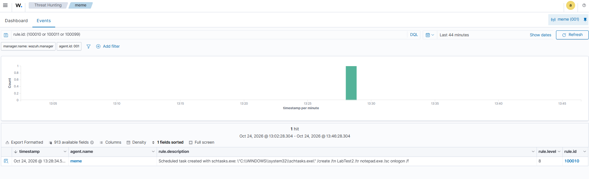
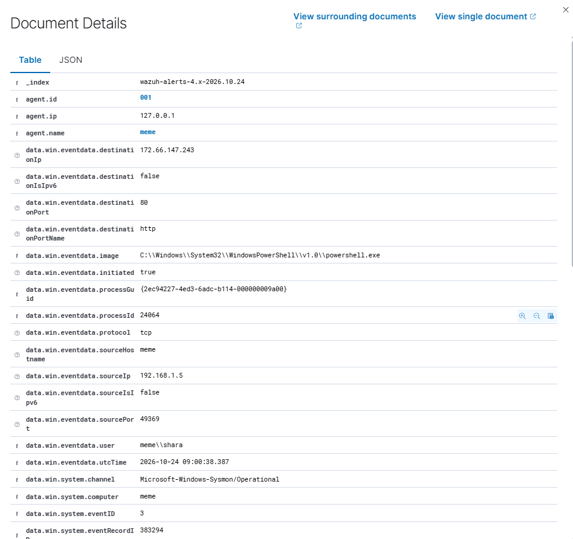
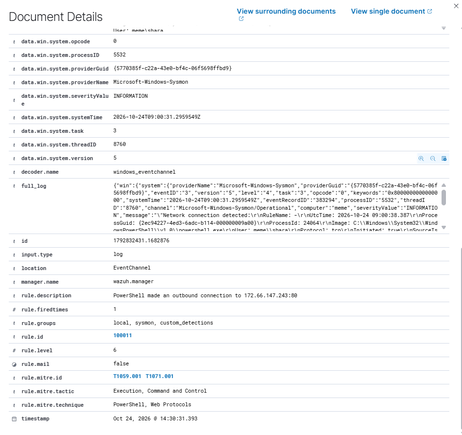
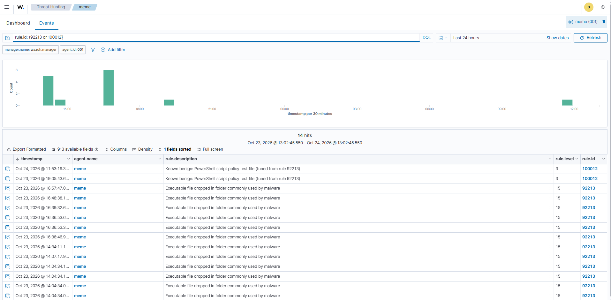

# Phase 5: Custom Wazuh Rules

## Overview

Phase 4 ended with two detection gaps and one noisy false positive. In this phase I wrote three custom Wazuh rules to close the gaps and tune the noise, then debugged why one of them did not fire at first. The root cause turned out to be a built-in rule that silently consumes the event before mine is evaluated.

| Problem from Phase 4 | Fix | Result |
| :--- | :--- | :--- |
| Scheduled task creation produced no alert | Rule **100010** (level 8, T1053.005) | Fires on `schtasks /create` |
| PowerShell outbound connection produced no alert | Rule **100011** (level 6, T1059.001, T1071.001) | Fires with destination IP and port |
| Rule 92213 (level 15) fired for a harmless PowerShell file | Rule **100012** (level 3), a narrow child of 92213 | 92213 no longer fires for that file |

| Item | Detail |
| :--- | :--- |
| SIEM | Wazuh 4.12.0 (single-node, Docker) |
| Endpoint | Windows 11 with Sysmon v15.21 (see [Phase 4](../04-sysmon-log-analysis/)) |
| Rules file | [`configs/sysmon_custom_rules.xml`](./configs/sysmon_custom_rules.xml) |

---

## 1. Design

- **Separate file in `etc/rules`.** Wazuh's default rules live in `/var/ossec/ruleset/rules/` and are overwritten on upgrade. Custom rules go in `/var/ossec/etc/rules/`, which survives upgrades.
- **Custom IDs 100000 to 120000.** This range is reserved for user rules, so they never collide with the default ruleset.
- **Child rules with `if_sid`.** The base Sysmon rules (61603 for process creation, 61605 for network connections) are level 0: they match every event but raise no alert. A custom rule hangs off one of them and adds the conditions that make an event interesting.
- **Validate before restarting.** `wazuh-analysisd -t` checks every rule file for errors, so a typo cannot take the manager down.

---

## 2. The rules

### 100010: Scheduled task created (level 8)

Child of 61603. Matches `schtasks.exe` with `/create` in the command line.



The alert fired at 13:28:34 for `schtasks.exe /create /tn LabTest2 /tr notepad.exe /sc onlogon /f`.

### 100011: PowerShell outbound connection (level 6)

Child of **92101** (see the debugging section for why not 61605). Matches `powershell.exe` with `initiated` equal to `true`, and puts the destination IP and port in the description.




The alert reads *PowerShell made an outbound connection to 172.66.147.243:80* and carries MITRE T1059.001 (PowerShell) and T1071.001 (Web Protocols).

### 100012: Tuning for the PowerShell policy-test file (level 3)

Child of 92213. It lowers the level only when **both** conditions hold: the image is the genuine `WindowsPowerShell\v1.0\powershell.exe`, and the file is `__PSScriptPolicyTest_<random>.<random>.ps1` in the user's Temp folder.



Every 92213 row (level 15) is from before the rule existed. The 100012 rows (level 3) are the same PowerShell behaviour after it. I tuned the rule instead of disabling 92213 because 92213 still catches real malware drops into Temp.

---

## 3. Debugging notes

Two of the three rules did not work on the first attempt. These are the parts worth remembering.

### Rule 100012 did not match: doubled backslashes

The first version used a single backslash between path parts (`\\AppData\\Local\\Temp`). It never matched. Opening an alert in the dashboard showed the stored value as `C:\\Windows\\System32\\...` with **doubled** backslashes, because the path is escaped on its way through Windows event JSON. The fix was `\\+` (one or more backslashes) in every separator.

### Rule 100011 never fired: a built-in rule got there first

Sysmon logged the connection (confirmed with `Get-WinEvent`), the event reached the manager (confirmed by turning on `logall_json` for a few minutes and finding it in `archives.json`), and the field values matched my rule. Even a debug rule with no conditions other than its parent did not fire. The manager's `alerts.json` showed no alert at all.

The cause was in the default ruleset:

```xml
<rule id="92101" level="0">
  <if_group>sysmon_event3</if_group>
  <field name="win.eventdata.image" type="pcre2">(?i)\\powershell\.exe</field>
  <field name="win.eventdata.protocol">^tcp$</field>
  <description>Powershell process communicating over TCP</description>
</rule>
```

Wazuh evaluates the children of a rule in order and **uses the first one that matches**. Rule 92101 matches every PowerShell TCP connection at level 0, so it consumed the event and my sibling rule under 61605 was never reached. Making 100011 a child of 92101 instead fixed it, and it fired on the next test.

| Step | What it proved |
| :--- | :--- |
| `Get-WinEvent` on the Sysmon log | Sysmon logs the event: the gap is not in logging |
| `logall_json` and `archives.json` | The event reaches the manager and decodes correctly |
| `grep` on `alerts.json` | The manager never produced an alert: the rule chain was the problem |
| Reading `0810-sysmon_id_3.xml` | Found the sibling rule 92101 |

I also tried Wazuh's `wazuh-logtest` with a hand-built event. It did not start the Windows rule chain, because the Windows event channel decoder is built into the engine and only runs for events from a real agent. Testing with real agent events was the reliable method here.

---

## 4. Trade-offs

- **100011 is noisy by design.** On a real network PowerShell connects out for many legitimate reasons (updates, module downloads, admin scripts). In production I would keep it at a low level and narrow it, for example by alerting only on connections to non-private addresses, on unusual destination ports, or when the parent process is an Office application or script host.
- **Tuning rules create blind spots if they are broad.** 100012 requires both the exact binary path and the exact filename pattern. A looser rule such as "any PowerShell file in Temp" would hide real droppers.
- **A level-0 rule can hide events from later rules.** Rules from different sources can overlap, and ordering matters.

---

## 5. Lessons learned

- **A missing alert has several possible causes.** Logging, delivery, decoding and rules are separate stages. I checked each one in turn instead of guessing, which found the cause much faster.
- **Look at the stored value, not the one you expect.** The doubled backslashes were only visible in the alert's own fields.
- **Check what already matches before adding a rule.** Searching the default ruleset for the same event type (`grep -rn sysmon_event3`) would have found 92101 on day one.
- **Always validate rules before restarting the manager** with `wazuh-analysisd -t`.
- **Turn debugging switches off afterwards.** Full-event archiving grows quickly, so I enabled it for a few minutes and reverted it.

## Next

Phase 6 will integrate VirusTotal to check file hashes automatically, followed by threat hunting with inventory data.
